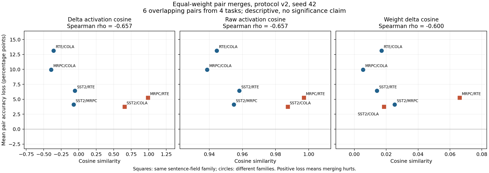

# Protocol-v2：合并基线与六任务对诊断

**后续更新**：seeds 43/44 已完成，三次训练汇总见 [复现报告](REPLICATION-2026-10-25.md)。本文保留 seed 42 阶段记录。

日期：2026-10-25。模型、训练预算与原 seed 42 adapter 银行沿用 [BUILD.md](BUILD.md)。本轮没有重新训练；使用 task ID 选择各任务原有分类头，仅合并 backbone。

**本轮结论**：Task Arithmetic 在本轮四任务主指标均值上高于平均合并，但所有合并方法仍低于 individual。激活相似度与较小的任务对合并损失有方向一致的描述性相关；raw 与 Δactivation 的 Spearman 结果相同，尚不能声称 Δactivation 更优，也不能宣称核心方法已验证。

## 方案与验证

参数网格和分析方向在新评估前固定：[方案与源码指纹](artifacts/merge-study-plan-2026-10-25.json)、[运行配置](configs/merge-study-v2.json)。共 17 组配置，其中四任务 TA scale=0.25 与 average 等价，不是独立方法改善。

- Task Arithmetic scale：0.25 / 0.5 / 1；TIES density：0.2 / 0.5，scale：0.5 / 1；DARE density：0.9 / 0.5 / 0.1，scale：0.25 / 0.5 / 1。density 均为**保留率**。
- 各任务最多 256 条 calibration（RTE 249 条），只按 calibration 四任务主指标均值选择参数；先写入 selection.json 锁定参数，才加载新评估中的 validation。
- 主指标为 SST-2 accuracy、MRPC (accuracy+F1)/2、RTE accuracy、CoLA MCC，按原始数值取四任务均值。它是本项目的子集汇总，**不是官方完整 GLUE 分数**。另报 mean accuracy 描述干扰，不能代替 CoLA MCC。
- TIES 沿用每矩阵 top-k、幅值选符号、同符号 disjoint mean；这是明确披露的实现粒度。原方法依次裁剪小更新、协调符号并合并一致项。[TIES 原论文](https://arxiv.org/abs/2306.01708)。DARE 先随机丢弃并重缩放 ΔW，再按 Task Arithmetic 合并；本轮固定 mask seed 42。[DARE 原论文](https://arxiv.org/abs/2311.03099)。

新评估器从不可变 base 参数重建每个状态，单独装入任务头。微型 Qwen 的 50 次状态往返检查通过；真实模型上四个 individual 的 logits 与原评估器完全一致，average 的最大绝对 logits 误差为 9.54×10⁻⁶。随后完整 validation 上所有 individual / average 指标与前轮逐项一致。

## Calibration 选中的参数

| 方法 | Scale | 保留率 | Calibration 主指标均值 |
|---|---:|---:|---:|
| Average | 1.0 | 1.0 | 0.6147 |
| Task Arithmetic | 0.5 | 1.0 | 0.6604 |
| TIES（每矩阵） | 1.0 | 0.2 | 0.6524 |
| DARE + TA | 1.0 | 0.5 | 0.6700 |

Average 的 scale=1 表示取 ΔW 均值；TA/DARE 的 scale 乘在 ΔW 求和上；TIES 的 scale 乘在裁剪后同符号均值上，不能跨方法把相同 scale 当成相同权重范数。各方法选中的参数固定后全部报告 validation，没有按 validation 换参数。

## 完整 validation 结果

SST-2 / MRPC / RTE / CoLA 分别为 872 / 408 / 277 / 1,043 条，统一 float32、同一 batch、同一数据协议和任务头。

| 方法 | SST-2 acc | MRPC F1 | RTE acc | CoLA MCC | 主指标均值 | Mean accuracy |
|---|---:|---:|---:|---:|---:|---:|
| Individual | 92.09% | 0.8866 | 76.17% | 0.5284 | 0.7686 | 83.19% |
| Average | 86.12% | 0.8460 | 59.57% | 0.1952 | 0.6171 | 73.88% |
| Task Arithmetic | 88.99% | 0.7984 | 62.82% | 0.3257 | 0.6542 | 75.22% |
| TIES（每矩阵） | 90.94% | 0.7115 | 59.21% | 0.4102 | 0.6511 | 73.61% |
| DARE + TA | 72.71% | 0.8444 | 53.79% | 0.4509 | 0.6316 | 70.25% |

不能只看一个汇总：TIES 改善了 CoLA MCC，但 MRPC/RTE 更差；DARE 在 calibration 汇总最高，validation 上却出现 SST-2/RTE 明显退化。应保留这些失败和权衡，不能改选 validation 表现更好的 DARE 参数。当前网格是有界比较，不是各方法的最优性证明。

## 六个任务对

每对使用 0.5ΔWᵢ+0.5ΔWⱼ，分别在两任务完整 validation 上使用各自原头。平均 accuracy 损失是两任务 individual accuracy 减去 pair-merged accuracy 后取平均；正值代表退化。相似度使用与前轮相同的 128 条共同 calibration 输入，每任务 32 条、最后层 mask-aware mean pooling；Δactivation=adapter−base。

| 任务对 | Δactivation cos | Raw cos | ΔW cos | 平均 acc 损失（百分点） | 平均主指标损失 |
|---|---:|---:|---:|---:|---:|
| SST2 / MRPC | -0.0731 | 0.9549 | 0.0253 | 4.11 | 0.0396 |
| SST2 / RTE | -0.0541 | 0.9581 | 0.0142 | 6.42 | 0.0642 |
| SST2 / COLA | 0.6558 | 0.9873 | 0.0186 | 3.74 | 0.0662 |
| MRPC / RTE | 0.9888 | 0.9970 | 0.0661 | 5.26 | 0.0480 |
| MRPC / COLA | -0.3934 | 0.9387 | 0.0054 | 9.96 | 0.2340 |
| RTE / COLA | -0.3596 | 0.9445 | 0.0171 | 13.15 | 0.2590 |

| 相似度 vs 平均 accuracy 损失 | Pearson r | Spearman ρ |
|---|---:|---:|
| Δactivation cosine | -0.6731 | -0.6571 |
| raw activation cosine | -0.6818 | -0.6571 |
| ΔW cosine | -0.3818 | -0.6000 |

[可导出 PDF](artifacts/merge-study-pairs-2026-10-25.pdf)。负相关符合“更相似时合并损失通常较小”的方向，但不能提升为单调规律：MRPC/RTE 相似度最高，仍损失 5.26 个百分点；SST-2/MRPC 的相似度稍负，损失却只有 4.11 个百分点。

敏感性检查：Δactivation 对四种 probe 来源分别计算时 Spearman ρ 为 −0.7714 / −0.6571 / −0.6571 / −0.6571；逐次移除一个任务对时 ρ 范围为 −0.8 到 −0.5。对主指标损失的相关性为 Pearson −0.6758 / Spearman −0.5429。

## 解释边界与下一步

六个任务对来自四个任务，彼此共享任务，不能作为六个独立观测做普通显著性推断。本轮是一个训练 seed、一个 DARE mask seed；不报告 p 值或已证实的统计优势。

Raw 与 Δactivation 的 Spearman 完全相同；ΔW cosine 也达到 −0.6。当前没有证据证明 Δactivation 带来额外预测价值。高激活相似度的两对也恰好分别属于单句任务和句对任务，可能同时反映输入模板/任务类型；按 probe 来源分组稳定并不能排除此混杂。

接下来先用同一预定方案补齐训练 seeds 43/44，按训练 seed 汇总波动，保留任务共享结构；DARE mask 的随机性另作消融。然后在 calibration 内比较按层、中心化/CKA、范数等功能信号与 raw/ΔW 控制，验证增量价值，再设计 activation-aware 静态权重或路由。不依据本轮 validation 反复选择“最好看的相似度”。

## 证据与复现

- [完整结果 JSON](artifacts/merge-study-summary-2026-10-25.json)：17 组 calibration、5 组 validation（含 individual）、6 个任务对、logits 核验和相关性。
- [代码与命令](code/merge_study/README.md)。在原银行上运行，不改变原 adapter；日志与原始 selection/manifests 随备份保存。
- 本地实验归档（private local archive; not distributed）、[SHA/文件清单](artifacts/merge-study-backup-2026-10-25.json)。归档包含本轮执行代码、冻结配置、selection/manifests、结果、绘图代码与 PNG/PDF；引用前轮 8-adapter 备份，不重复打包权重。

本轮远端 wall time 176.8 秒，A100 上最高 PyTorch peak allocated 3.85 GiB（交叉核验时同时保留两个模型）。实验归档 183,911 字节，远端传输 SHA、最终本地归档 SHA、ZIP CRC、执行源码指纹及参数锁定指纹均已核对。
