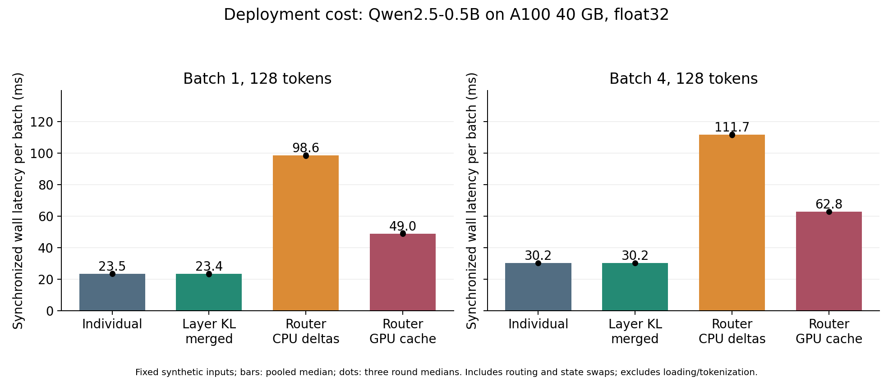
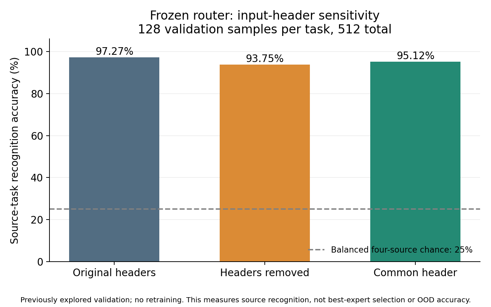

# Part 2 补充实验：部署成本与输入格式诊断

2026-11-09，Group 13。所有模型计算、测试和绘图均在 Colab **NVIDIA A100-SXM4-40GB** 上执行；本机仅编辑、传输与核验小文件。没有重新训练 LoRA，也没有改变旧实验的准确率结论。

## 本轮解决的问题

原项目已证明工程可运行，但缺少部署成本实测；router 的高来源识别率也可能混入输入字段标题的影响。本轮分别测量成本、固定 router 后改变标题，补上两项可以在展示中核对的证据。它们不等于证明 activation 信号独特有效，更不等于 Part 2 已全部完成。

证据与图表：[归档目录](artifacts/part2-followup-2026-11-09/README.md)。代码：[成本测量](code/benchmark_deployment.py)、[标题诊断](code/diagnose_router_headers.py)。归档保留确切运行源码、计划、每次计时、样本 ID、混淆矩阵、环境及 SHA 清单。

## 1. 环境和恢复验证

- 源码基线：团队分支 `feat/team-colab`，`a512f7536a863a9ea7f89ff01a52e2cbd6087faf`。
- Qwen2.5-0.5B 固定模型版本：`060db6499f32faf8b98477b0a26969ef7d8b9987`；实际下载并加载后核对 commit。
- Python 3.13.16，PyTorch **2.14.1+cu130**，transformers 4.57.6、peft 0.18.1、datasets 4.5.0、accelerate 1.12.0、safetensors 0.7.0。
- 新 Colab VM 未保留旧文件。恢复 seed 42 的四个 adapter 与相关 JSON，共 27 文件；完整 ZIP SHA、CRC 和逐文件 SHA 全部通过。
- 七组既有 unittest 共 17 项通过，包含数学、输入协议、系数梯度、状态替换、微型 Qwen 训练/保存/加载/合并和 CSA。见 [readiness.json](artifacts/part2-followup-2026-11-09/readiness.json)。

系统继承环境的 pip 提示若干与 gradio/gcsfs/diffusers 有关的依赖冲突；本项目实际使用的上述固定依赖、七组测试和两项真实模型流程均通过。不能把本次验证写成“整个 Colab 全局环境 pip check 无冲突”。原记录使用过 PyTorch 2.11；本轮保留新 runtime 的 CUDA torch，因此不把跨日期时间差解释为算法改进。

## 2. 部署成本：测量范围

使用同一张 A100、float32、关闭 TF32；batch=1/4、序列长度=32/128。输入为固定 seed 生成的 token IDs，attention mask 全为有效 token。每个方法/形状 5 次 warmup，3 轮 × 30 次同步计时，共 90 次 timed trials。先保存计划，再开始测量；CPU-delta 阶段的静态方法在每轮打乱顺序。GPU-cache 阶段随后单独执行，不宣称完整热状态随机交错。

计时包含模型前向，以及 router 中的 base 特征、CPU 线性来源分类、按 expert 分组、权重状态切换和 expert 前向。排除 tokenizer、输入拷贝、模型下载/加载与一次性的静态合并。这里测的是分类/prefill，不是逐 token 生成。

静态方法在计时前已将 ΔW 合入 backbone。`individual` 也以同样方式 materialize，避免拿不同部署实现强行比较。router 是当前 dense-delta 替换原型，增加 GPU 缓存版本以分离 CPU→GPU 传输开销；不能把它当成所有 PEFT/hot-swap 实现的速度上限或下限。

## 3. 成本结果

以下为最终含 expert 分组记录的一轮，序列长度固定 128。第一轮结果也保留在归档中，但不与最终轮混合统计。表中显存是 PyTorch peak allocated，包含 evaluator 的 base shadow/cache 等辅助张量，不是最小化生产部署显存。

| 方法 | Batch | Median ms / batch | P95 ms | Samples/s | Peak allocated GiB |
|---|---:|---:|---:|---:|---:|
| Individual，materialized | 1 | 23.459 | 23.888 | 42.63 | 1.940 |
| Average，materialized | 1 | 23.556 | 24.471 | 42.45 | 1.940 |
| Layer KL，materialized | 1 | 23.375 | 27.724 | 42.78 | 1.940 |
| Router，CPU dense delta 切换 | 1 | 98.589 | 102.461 | 10.14 | 1.940 |
| Router，GPU 缓存 dense delta | 1 | 48.971 | 51.525 | 20.42 | 2.350 |
| Individual，materialized | 4 | 30.184 | 30.463 | 132.52 | 1.967 |
| Average，materialized | 4 | 30.172 | 30.382 | 132.57 | 1.967 |
| Layer KL，materialized | 4 | 30.212 | 30.326 | 132.40 | 1.967 |
| Router，CPU dense delta 切换 | 4 | 111.735 | 113.127 | 35.80 | 1.967 |
| Router，GPU 缓存 dense delta | 4 | 62.810 | 63.246 | 63.68 | 2.378 |



可支持的解释：静态合并后均为一次 backbone 前向，这几个 materialized 模型的耗时接近；不能把亚毫秒波动说成 Layer KL 加速。batch=1、128 tokens 时，CPU-delta router 约为 individual 的 **4.20×**，GPU-cache router 约 **2.09×**。缓存降低了当前实现的交换成本，但额外 base 前向仍存在。

**批处理需要修正旧口头表述**：每批前向次数是 `1 + 该批被分配到的不同 expert 数`，并非永远两次。此轮 batch=4、32 tokens 的固定输入分到两个 expert，因此三次前向；128 tokens 的固定输入全部分到同一 expert，因此两次。32 tokens 的路由延迟反而可能更大，不能用长度单独解释；归档中记录了具体 route assignment。

这不是新的准确率实验，也没有比较未知任务条件。仍以已知 task ID 提供 SST-2 分类头；在当前 task-aware 协议里，直接选择对应 adapter 本来就可用。router 的额外成本需与这个参照一起讲，不能仅与 random routing 比较。

## 4. 存储到底包含什么

| 项目 | 本轮计数 |
|---|---:|
| 一份 base classifier 参数 payload，float32 | 1,976,138,240 bytes，约 1.840 GiB |
| 四个 adapter 目录合计，含各自任务头及配置 | 8,733,776 bytes，约 8.329 MiB |
| 四个任务头参数 payload | 28,672 bytes |
| Linear router + scaler，float64 数组 payload | 43,040 bytes |
| 逐层系数拟合的可训练标量 | 97 个；float32 payload 为 388 bytes |
| 四套缓存 dense ΔW 的 GPU payload | 352,321,536 bytes，336 MiB |
| 为恢复纯 base 状态另存的 zero ΔW | 88,080,384 bytes，84 MiB |

97 个标量是**额外训练参数量**，不是整个模型大小，也不表示部署只需 388 bytes。恢复合并模型仍需要 base、adapter/合并权重和任务头；JSON/文件格式另有开销。GPU-cache 版本额外常驻约 420 MiB 的 delta/zero payload，解释了显存上升。

比较存储时应以“共享一份 base + 四个小 adapter”为真实参照。不能拿四个完整 backbone 的大小作为我们原先 LoRA bank 的实际开销，也不能把 8.329 MiB adapter 文件和展开后的 336 MiB dense delta 当成同一种表示。静态合并保留一套 backbone 能简化执行，但在本配置中不应夸大相对共享-base bank 的总存储节省。

## 5. 冻结 router 的标题诊断

四个任务分别取 protocol-v2 固定打乱顺序中的前 128 条 validation，共 512 条。归档保留 idx 与 dataset fingerprint。模型、scaler 和线性分类器均冻结，不重新拟合、不重新选 C。只评价数据来源 task ID；不计算任务分类准确率，也不使用 class label 来训练或选择。

三种输入：原格式；去除构造的 `Text:` / `Sentence A:` / `Sentence B:` 标题；去除后统一加 `Input:`。保留原来已截断后的内容 token，不重新截断；句对保留换行边界，并逐样本检查长度和标题定位。它不能消除句子数量、语料风格或长度等所有来源线索。

| 输入变体 | 来源识别率 | 相对原格式改判比例 |
|---|---:|---:|
| 原格式 | 97.2656% | 0% |
| 去标题 | 93.7500% | 5.8594% |
| 统一标题 | 95.1172% | 4.4922% |



去标题下降 **3.5156 个百分点**，但仍远高于平衡四来源的 25% chance 参照。CoLA 从 99.22% 降至 87.50%，MRPC 则从 94.53% 升至 96.88%；并非所有任务同向下降。逐任务混淆矩阵在原始 JSON 中。

可支持：“来源分类对标题有敏感性，高识别率不只依靠显式字段标题。”不能支持：“router 理解了任务语义”“排除了所有风格混杂”“能选择最优 expert”“获得 OOD 泛化优势”。标题编辑同时改变位置和长度，本身是输入扰动；validation 以前被多次用于探索，这不是新的盲测集。

## 6. 展示与问答怎么使用

**部署成本，英文短答：**

> We measured deployment costs on the same A100 GPU with fixed input shapes. Once materialized, the static merges have roughly the same single-forward cost as an individual model. Our router adds a base-feature pass and expert dispatch. GPU caching reduces state-transfer overhead, but it still costs about twice as much for a single input in this configuration. We therefore report the trade-off rather than claim a deployment advantage.

**教授问：高 router accuracy 是否只来自 Text / Sentence A 标题？**

> We froze the original router and removed or standardized the field headers without retraining. Source recognition decreased from 97.27% to 93.75% after header removal on a fixed 512-example subset. Explicit headers matter, but they do not explain all source recognition. Dataset style and sentence structure may still be cues, and source recognition is not the same as selecting the best expert.

**教授问：为什么同样 batch=4，短输入的 router 反而慢？**

> Routing can split a batch into several expert groups. The cost depends on both sequence length and the number of active experts. Our 32-token batch used two experts, whereas the 128-token batch used one. We recorded the assignments and forward-call counts instead of attributing the difference to sequence length alone.

**教授问：97 个参数是不是模型非常小？**

> Ninety-seven is the number of trainable merging coefficients, not the full deployment footprint. The backbone and task heads remain necessary. We separately report adapter files, coefficient payloads and dense delta caches so that parameter efficiency is not confused with total model storage.

建议给 PPT 制作者的材料：两张 PNG、成本表、标题诊断表，以及上述短答。旧三 seed 主指标应从原报告引用，与本轮 seed42 成本和固定样本诊断明确分开。

## 7. 下一步仍需完成

最高优先级是**全流程独立的数据权限与同容量对照**。旧 teacher 的 checkpoint 选择看过整个 calibration；只把现在的 calibration 再切两半，不能补回独立性。如果要提出更强的最终主张，应冻结新的训练/teacher-selection/系数-fit/系数-selection/最终评估划分，并在新协议下重新训练所需 adapter；不能复用看过最终 holdout 的旧 teacher，再称它独立。

建议收紧为静态合并主线，保留 CE 与 KL 同容量、同步数对照，把 router 作为成本和混杂诊断。是否继续未知任务路由，需要先定义任务头选择或统一输出；不能用已知头条件下的来源识别率替代这个问题。该收敛是项目建议，不是已经得到的新方法优势。

本轮尚未完成新协议三 seed 重训、activation 信号的独特增益、独立 OOD 成功、队友首次复评或正式课程交付。Group 13 实际 Part 2 场次仍需按课程信息核对。

## 复现入口

在已恢复 seed42 bank 的 Colab GPU 环境、仓库根目录执行；输出目录必须不存在：

```bash
export USE_TF=0 USE_FLAX=0 TOKENIZERS_PARALLELISM=false
python code/benchmark_deployment.py \
  --bank outputs/bank-v2-a100-s42 --output outputs/my-deployment-cost
python code/diagnose_router_headers.py \
  --samples-per-task 128 --output outputs/my-router-header-check
```

依赖见 requirements 和固定配置；本轮确切运行源码另存于证据目录。不要在本地运行这些模型脚本；它们均要求 CUDA。
