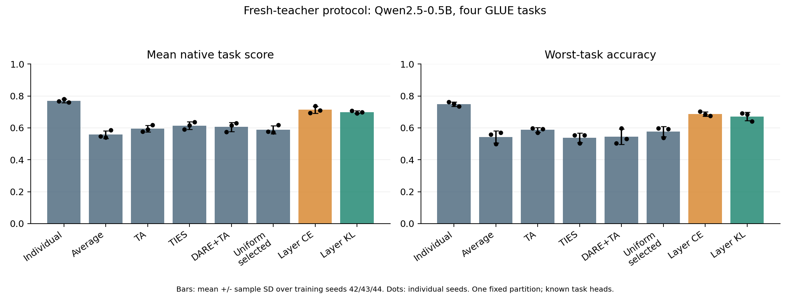
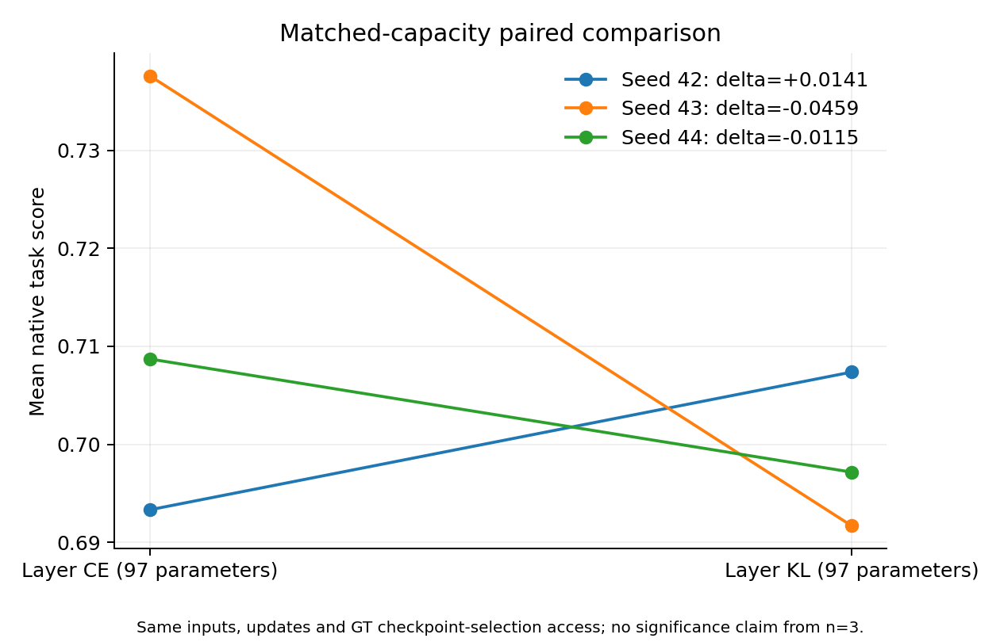
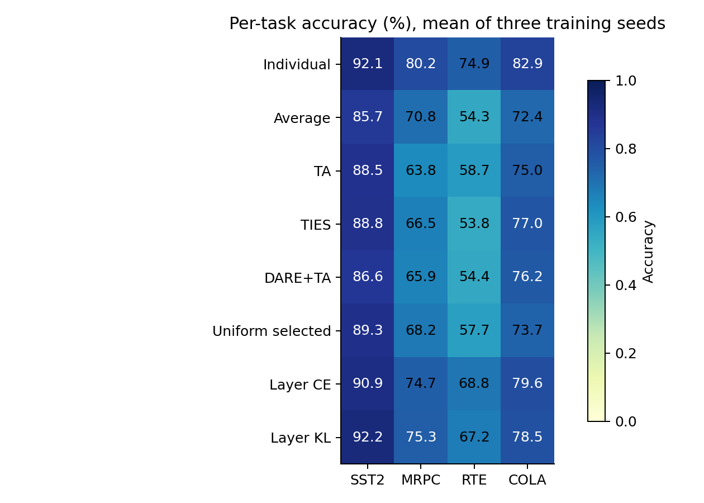

# Part 2 新协议三 seed 实验与展示材料

2026-11-09，Group 13。A100-SXM4-40GB 完成全轮计算：12 个新 teacher、三 seed 同容量 CE/KL、固定权重空间基线、权限审计、统计和图表。最终状态以 [原始证据](artifacts/independent-v3-2026-11-09/README.md) 为准。本机仅编辑与传输文件。

## 可以报告的结论

KL−CE 的三 seed 主指标配对均值差为 **-0.014468**，KL 在 **1/3** 个 seed 较高。本轮没有建立 teacher 软输出相对同容量 CE 的平均优势。

同时，学习少量系数在本设置中改善了固定权重网格：主指标 CE **0.7132±0.0225**、KL **0.6987±0.0080**，而本轮最强权重基线 TIES 为 **0.6146±0.0240**；individual 为 **0.7695±0.0114**。可以把这讲成“校准后的静态混合减少了当前基线的性能损失，尚不能消除与 individual 的差距”。CE 额外使用 fit 标签，KL 使用 teacher 输出，权重基线没有同样的 fit 优化；相同 selection 权限不等于总信息或计算预算相同。

权重空间基线中，本轮最终均值最高的是 **TIES（本实现）**；KL 与它的主指标均值差为 **+0.084159**。这只是固定候选和固定最终区上的描述性比较，不据此扩展超参搜索。Individual 是 task-aware 参照：当前本来知道 task ID，因此合并与路由都需要说明相对直接 adapter 选择的质量损失。

本轮回答的是 teacher-output KL 对静态系数学习是否有帮助；KL 匹配最终 logits，不直接验证中间 activation cosine 假设。逐层系数、蒸馏、activation 统计合并均有先例，见 [相关工作](PART2-RELATED-WORK.zh-CN.md)。不将本轮结果改称新 SOTA、未知任务路由成功或 OOD 稳健。

## 1. 数据权限和运行条件

- 固定模型 commit：`060db6499f32faf8b98477b0a26969ef7d8b9987`；数据 commit：`bcdcba79d07bc864c1c254ccfcedcce55bcc9a8c`。
- 来源均为原 GLUE train。五区分别用于训练、teacher 选择、系数 fit、系数/基线选择、最终评价。最终区在代码中沿用 validation 名称，**不是官方 validation**。
- SST-2/MRPC/RTE/CoLA 的 train 数量分别 4096/2391/1571/4096；其余各任务 teacher-select/fit/coeff-select/final 分别128/128/128/256。
- 完整字段 tuple 规范化去重并按内容 hash 分区，任务内 IDs 与跨任务完整内容 hash 不跨 role；不保证排除单句局部、近重复或预训练污染。
- teacher 从头重新训练，3 epochs、LoRA r=8/alpha=16、q/v 模块、max length128、batch16；按专属 teacher-select loss 选 epoch。
- CE/KL 均97可训练标量、120steps、batch8、相同初始化和抽样顺序；base、A/B、head 均冻结。KL T=2；两者用同一 coefficient-selection GT 主指标选 step，所以整个流程不是无监督。
- 三 seed42/43/44共用一个固定数据划分；已有 GLUE 探索历史，所以只是本轮内部隔离最终评价，不是全新外部盲测。
- 权重基线复用旧17候选网格，DARE mask seed42；selection 样本一致，候选数量/优化计算不完全一致。

完整规则：[独立协议 v3](INDEPENDENT-PROTOCOL-V3.zh-CN.md)。清单 SHA256：`526c3ae3aefebf36f651c0518d4a69b1c51d8c2e9d5145063f791b0b363386eb`。

## 2. 主结果（mean ± sample SD，三训练 seed）

| 方法 | 四任务主指标均值 | Mean accuracy | Worst-task accuracy | Mean accuracy drop vs individual |
|---|---:|---:|---:|---:|
| Individual / task ID | 0.7695 ± 0.0114 | 0.8252 ± 0.0083 | 0.7487 ± 0.0137 | 0.0000 ± 0.0000 |
| Average | 0.5578 ± 0.0246 | 0.7080 ± 0.0068 | 0.5430 ± 0.0377 | 0.1172 ± 0.0152 |
| Task Arithmetic | 0.5954 ± 0.0211 | 0.7152 ± 0.0132 | 0.5872 ± 0.0148 | 0.1100 ± 0.0215 |
| TIES（本实现） | 0.6146 ± 0.0240 | 0.7152 ± 0.0096 | 0.5378 ± 0.0293 | 0.1100 ± 0.0140 |
| DARE+TA | 0.6065 ± 0.0287 | 0.7077 ± 0.0131 | 0.5443 ± 0.0482 | 0.1175 ± 0.0092 |
| Uniform，选择 gain | 0.5889 ± 0.0256 | 0.7223 ± 0.0069 | 0.5768 ± 0.0328 | 0.1029 ± 0.0130 |
| Layer CE，97 参数 | 0.7132 ± 0.0225 | 0.7848 ± 0.0031 | 0.6875 ± 0.0141 | 0.0404 ± 0.0054 |
| Layer KL，97 参数 | 0.6987 ± 0.0080 | 0.7829 ± 0.0073 | 0.6719 ± 0.0273 | 0.0423 ± 0.0069 |

主指标为 SST-2/RTE accuracy、MRPC (accuracy+F1)/2、CoLA MCC 的宏平均，不是完整官方 GLUE 分数。Worst accuracy 先在每个 seed 内取四任务 accuracy 最小值，再跨 seed 汇总。Drop 为 individual accuracy−method accuracy，正数表示下降，不是顺序学习 forgetting。



## 3. 同容量配对结果

| Training seed | KL−CE 主指标 | KL−CE mean accuracy | KL−CE worst accuracy |
|---|---:|---:|---:|
| 42 | +0.014052 | +0.003906 | -0.011719 |
| 43 | -0.045911 | -0.003906 | +0.000000 |
| 44 | -0.011545 | -0.005859 | -0.035156 |



每个点是一组完整 teacher bank 的训练 seed，不把四个任务或重复计时视为独立重复。图中连线是配对关系，不能根据 n=3 宣称显著性。

## 4. 逐任务 accuracy（三 seed 均值）

| 方法 | SST-2 | MRPC | RTE | CoLA |
|---|---:|---:|---:|---:|
| Individual / task ID | 92.06% | 80.21% | 74.87% | 82.94% |
| Average | 85.68% | 70.83% | 54.30% | 72.40% |
| Task Arithmetic | 88.54% | 63.80% | 58.72% | 75.00% |
| TIES（本实现） | 88.80% | 66.54% | 53.78% | 76.95% |
| DARE+TA | 86.59% | 65.89% | 54.43% | 76.17% |
| Uniform，选择 gain | 89.32% | 68.23% | 57.68% | 73.70% |
| Layer CE，97 参数 | 90.89% | 74.74% | 68.75% | 79.56% |
| Layer KL，97 参数 | 92.19% | 75.26% | 67.19% | 78.52% |



CoLA accuracy 仅作可比性辅助，应同时查看 MCC；MRPC 同时查看 F1。全部精度见 [逐任务 CSV](artifacts/independent-v3-2026-11-09/per-task.csv) 和 [逐 seed CSV](artifacts/independent-v3-2026-11-09/per-seed.csv)。不能只展示对方法最有利的一列。

## 5. 工程验证与备份

云端开跑前13项检查通过，覆盖内容分区、输入协议、合并数学、系数梯度冻结及独立状态切换；随后实际完成12次 teacher 训练与三组完整系数拟合。每组包含 MixedLinear 与物化 ΔW logits parity、非零系数梯度、冻结参数无梯度检查。

最终审计再次核对 teacher训练/选择 IDs、系数fit/selection IDs、manifest SHA、模型 revision、97参数对等，以及各最终区样本数。保存所有 step 历史与 selection 锁，未用最终分数重新调参。

[恢复验证](artifacts/independent-v3-restore-2026-11-09.json) 核对 131 个归档文件、12 个 adapter，成功重建目录并迁移 manifest；已验证已有目录、越界 ZIP 路径和坏 SHA 均被拒绝。恢复器见 [代码](code/restore_independent_backup.py)，操作见 [协议末节](INDEPENDENT-PROTOCOL-V3.zh-CN.md)。此验证是文件与运行布局验证，没有冒充第二次完整模型复评。

证据目录含确切执行源码、配置、数据 IDs/hash、teacher run/manifests、完整方法统计与图表。另有12 adapter及日志的 checkpoint ZIP；Hub 固定 base/tokenizer 不重复打包。两个 ZIP 均下载到系统默认 Downloads，并做完整 SHA、ZIP CRC 和逐文件 SHA 校验。

## 6. 给 PPT 制作者的具体材料

1. 问题页：一个 base、四个任务 LoRA；平均合并可能干扰。目标是测试功能输出监督在固定合并容量下是否有帮助。
2. 实现页：[协议图表和参数化](INDEPENDENT-PROTOCOL-V3.zh-CN.md)，明确24×4+1标量、冻结backbone/adapter/head、task-aware head。
3. 结果页：本报告的三seed方法比较、配对CE/KL和逐任务图；完整数值从CSV复制。
4. 成本页：复用 [A100部署报告](PART2-FOLLOWUP-2026-11-09.zh-CN.md) 的独立图表，注明旧seed42、固定synthetic inputs、float32。不能将该计时与新协议accuracy称同一实验。
5. 局限页：同模型四任务、三训练seed同一划分、GLUE历史探索、已知head、无新OOD优势。旧IMDb/PAWS负结果保留。
6. 讲解与QA：[一分钟流程、三分钟走读和26组中英问答](PART2-IMPLEMENTATION-QA.zh-CN.md)。

正式PPT仍由组员制作。本材料支持实现与解释，不代表课程展示/提交已经完成；Group13具体场次与正式提交要求仍待核对。

## 7. 从头复现

仅在Colab A100、已装固定依赖的仓库根目录执行，输出目录必须不存在：

```bash
export USE_TF=0 USE_FLAX=0 TOKENIZERS_PARALLELISM=false
python code/run_independent_study.py --output outputs/my-independent-v3
python code/independent_baselines.py --study outputs/my-independent-v3
python code/summarize_independent_study.py --study outputs/my-independent-v3 --output outputs/my-independent-v3/export
```

旧v2默认接口保留；v3必须从专属编排器进入并使用新teacher，不能恢复旧bank后套用“独立”名称。
