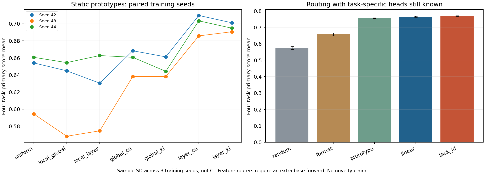

# 静态系数与路由原型：探索结果

首次接触的目标子集 [IMDb / PAWS 检查](TRANSFER-CHECK-2026-10-25.md) 也已完成：未看到逐层 KL 稳定迁移优势，PAWS 连 individual 也弱于多数类基线，需保留源模型/任务迁移与截断限制。

首次接触的目标子集 [IMDb / PAWS 检查](TRANSFER-CHECK-2026-10-25.md) 也已完成：未看到逐层 KL 稳定迁移优势，PAWS 连 individual 也弱于多数类基线，需保留源模型/任务迁移与截断限制。

后续 [选择标签控制](SELECTION-CONTROL-2026-10-25.md) 已完成：不向 selection 准则增加真实标签、改用 teacher KL 后，layer-KL 为 0.6996±0.0126；不建立对同容量 CE 的优势。下表保留原 GT 选择结果。

2026-10-25。沿用 [三 seed 银行](REPLICATION-2026-10-25.md)，没有重新训练 base、LoRA factors 或任务头。本轮把 prototype 做到可运行、可校验，尚未建立新方法的独特优势。

## 结果与对照

以下“四任务主指标均值”沿用 SST2 acc、MRPC (acc+F1)/2、RTE acc、CoLA MCC；不是官方完整 GLUE 分数。± 是 3 个训练 seed 的 sample SD。

| 静态方法 | 主指标 mean ± SD | SST2 acc | MRPC F1 | RTE acc | CoLA MCC |
|---|---:|---:|---:|---:|---:|
| uniform | 0.6365 ± 0.0365 | 88.99% | 0.7735 | 62.21% | 0.2835 |
| local_global | 0.6226 ± 0.0472 | 88.76% | 0.7203 | 59.93% | 0.3023 |
| local_layer | 0.6227 ± 0.0446 | 88.88% | 0.7110 | 58.48% | 0.3246 |
| global_ce | 0.6558 ± 0.0157 | 90.06% | 0.8377 | 65.34% | 0.2578 |
| global_kl | 0.6479 ± 0.0119 | 89.79% | 0.8345 | 66.67% | 0.2214 |
| layer_ce | 0.6997 ± 0.0124 | 91.25% | 0.8677 | 69.07% | 0.3601 |
| layer_kl | 0.6955 ± 0.0053 | 91.51% | 0.8697 | 69.55% | 0.3334 |

`uniform` 是在同一 coefficient-selection 半区选择 gain=1/2 的对照（三次均选 2）。局部响应匹配的全局/逐层权重未稳定胜过 uniform。端到端逐层系数更好，但同容量 `layer_ce` 的均值也达到约 0.700，`layer_kl` 约 0.696；不能把提升全部归因于 teacher 目标或 activation-aware 信号。两者仅 3 seeds，不作显著性结论。

## 局部响应匹配

在每个 adapter 自己任务的 32 条 calibration 输入上，对每层 q/v 的所有 LoRA 响应估计 Gram。用 simplex 二次优化拟合一个全局或每层四维非负系数，加入 beta=0/1 到统一权重的惩罚，再以 calibration 主指标从 gain=1/2 中选择。q/v 按输出维度和有效 token 数归一化，全局目标另对 block trace 归一化。

这是 [RegMean](https://arxiv.org/abs/2212.09849) 输出匹配思想下的受限 adapter-span 原型，不声称首创。统一输入、同权重的平方匹配最优解包含 uniform average，解析单元检查已验证；新增信息来自 task-conditioned 输入。局部二次目标下降不保证整个非线性模型改善，gain 又是单独选择的，不能把优化前的 surrogate 当成最终函数保真保证。

## 端到端静态系数

前 128 条 calibration/任务用于拟合，后半部分用于选择 step（RTE 121 条，其余 128）。每次拟合 120 steps，候选 step=0/30/60/90/120；step 0 保留初始 uniform gain 2。优化对象仅为 softmax 系数与一个公共 gain：global 5 个、layer 97 个可训练标量，base/LoRA A/B/任务头冻结。

比较 global CE、global teacher-KL、layer teacher-KL，并补充同容量、同步数的 layer CE。KL 用 individual teacher logits，温度 2；拟合阶段不用 class labels，但 checkpoint 选择仍用后半区 labels。CE 拟合还使用前半区 labels，因此不是完全相同信息预算。所有候选锁定后才评估该原型的 validation。

线性低秩计算与 materialized ΔW 的等价性、仅系数得到梯度、真实模型初始 logits 一致性均已检查。最终评估使用单个合并 backbone，而非把四个 expert 前向的训练实现冒充部署成本。

注意：原 teacher checkpoint 已用整个 calibration 选择，前期 baseline 与当前研究已多次查看 GLUE validation；上述半区仅对本次系数拟合/选择分开，不是全流程全新独立 holdout。结果是探索性证据。可训练系数/蒸馏均有相关工作，当前不声称算法新颖。

## 输入路由原型

Router 拟合目标是数据源 task ID，不是逐样本最优 expert；只看 frozen base 的最后层 mask-aware mean 特征。StandardScaler 仅 fit 在 calibration 前半区；linear 的 C=0.1/1/10 按后半区 source accuracy 选择。Prototype 使用相同标准化空间的类中心。Format 基线仅从真实输入的 Text / Sentence A 字段区分两种输入族，在族内随机选。所有 route decision 在三个 adapter seed 间共用。

| 路由 | Validation source accuracy | 任务主指标 mean ± SD | 每输入 backbone 前向数 |
|---|---:|---:|---:|
| random | 25.96% | 0.5746 ± 0.0089 | 1 |
| format | 51.85% | 0.6578 ± 0.0093 | 1 |
| prototype | 94.42% | 0.7568 ± 0.0018 | 2 |
| linear | 98.31% | 0.7653 ± 0.0033 | 2 |
| task_id | 100.00% | 0.7684 ± 0.0027 | 1 |

分类头仍由已知 task ID 提供，因此 `task_id` 直接选择对应 adapter 是当前信息协议下本来就可用的参照，已逐项复现 individual 指标。Feature router 接近它但需要额外一次 base 前向，不构成当前协议下的部署优势；也不能把高 source accuracy 解释为识别了哪个 adapter 对该例最有帮助。它可能识别的是数据集风格，不只是两种 header；OOD source/style 尚未验证。

## 证据与下一步

- [完整汇总](artifacts/prototype-aggregate-2026-10-25.json)，各 seed 的 functional、coefficient、同容量 CE 及 router JSON 见 [artifacts](artifacts/README.md)。
- 代码：[local-response](code/functional_merge/README.md)、[static fitting](code/coefficient_merge/README.md)、[router](code/router_v1/README.md)。原 LoRA 银行备份保留，当前系数、配置与实验记录已校验归档；合并权重可按保存系数重建。
- 下一步的关键对照是更严格的 calibration 分层/跨数据集验证、选择阶段是否还需 labels，以及相同参数容量与优化预算的比较。不要仅靠新增路由或更多相似度搜索来宣称 activation 信号有效。可将研究主线收紧为“哪些功能保真代理能预测并改善合并，以及何时失效”，并明确哪些改善来自容量。
