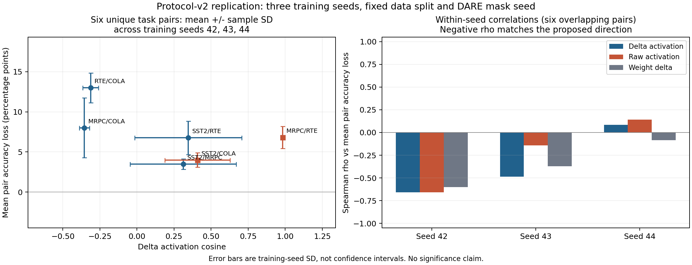

# Protocol-v2：三训练 seed 复现

日期：2026-10-25。接续 [seed 42 诊断](MERGE-STUDY-2026-10-25.md)，已完成训练 seeds **42 / 43 / 44** 的四任务银行、基线和六任务对实验。Δactivation 相似度与任务对 accuracy 损失的排序负相关在 2/3 次训练中出现，未能稳定复现（三次 Spearman ρ：-0.6571, -0.4857, +0.0857）；相对 raw 的排序负相关更强仅 1/3 次，相同 1/3 次。当前不能直接把 cosine 相似度作为安全合并规则，也没有证明它优于 raw/权重相似度。

## 固定的协议

- 同一 Qwen commit、rank 8 q/v LoRA、显式句子字段、长度 128、有效 batch 16、3 epochs；SST-2/CoLA 各 4,096 条，MRPC 3,301、RTE 2,241 条。固定 base seed 9501 与 train/calibration 划分，只改变训练 seed。
- 每个 seed 按同一 17 组网格、同一 calibration 主指标均值独立选参数，保存 selection 后才评估其新合并方法的完整 validation。没有按 validation 改网格或挑 seed。
- DARE mask seed 固定 42；本轮标准差测的是训练 seed 的波动，不覆盖掩码、数据重采样或换任务的变化。两个新增 seed 同时共享 A100，训练各限 4 个主机线程，输出目录独立。
- 所有模型均由 task ID 选择该任务训练好的原分类头；只合并 backbone，不是未知任务身份的统一分类器。

[重复前冻结的方案](artifacts/replication-plan-2026-10-25.json)。新评估器在每个 seed 都通过独立 logits 核验，并与该 seed 的 bank 全量 individual/average 指标逐项一致。

## 完整 validation：均值 ± 样本标准差

每列的 ± 是 **3 个训练 seed 的 sample SD，ddof=1**，不是置信区间。SST-2/RTE accuracy 以百分数报告；F1/MCC 取原始数值。四任务主指标均值 = SST-2 acc、MRPC (acc+F1)/2、RTE acc、CoLA MCC 的平均，不是官方完整 GLUE 分数。

| 方法 | SST-2 acc（%） | MRPC F1 | RTE acc（%） | CoLA MCC | 四任务主指标均值 |
|---|---:|---:|---:|---:|---:|
| Individual | 92.13 ± 0.29 | 0.8846 ± 0.0035 | 76.41 ± 0.42 | 0.5291 ± 0.0114 | 0.7684 ± 0.0027 |
| Average | 84.90 ± 1.15 | 0.8274 ± 0.0231 | 57.76 ± 2.53 | 0.2023 ± 0.0425 | 0.6063 ± 0.0219 |
| Task Arithmetic | 88.99 ± 1.15 | 0.7735 ± 0.0520 | 62.21 ± 4.54 | 0.2835 ± 0.0503 | 0.6365 ± 0.0365 |
| TIES（每矩阵） | 90.18 ± 0.75 | 0.7612 ± 0.0501 | 59.69 ± 5.07 | 0.3744 ± 0.0566 | 0.6526 ± 0.0284 |
| DARE + TA | 83.26 ± 9.17 | 0.7891 ± 0.0605 | 60.89 ± 7.04 | 0.3244 ± 0.1174 | 0.6323 ± 0.0295 |

补充 proposal 要求的跨任务 mean / worst accuracy（同样为三 seed mean ± SD，单位 %；不代替 CoLA MCC）：

| 方法 | Mean accuracy | Worst-task accuracy |
|---|---:|---:|
| Individual | 83.01 ± 0.32 | 76.41 ± 0.42 |
| Average | 72.62 ± 1.51 | 57.76 ± 2.53 |
| Task Arithmetic | 74.25 ± 2.61 | 62.21 ± 4.54 |
| TIES（每矩阵） | 74.24 ± 1.91 | 59.69 ± 5.07 |
| DARE + TA | 72.97 ± 3.10 | 60.89 ± 7.04 |

逐 seed 的参数选择如下（density=保留率；TA/DARE scale 乘求和，TIES scale 乘裁剪后的同符号均值）：

| Seed | TA scale | TIES density / scale | DARE density / scale |
|---|---:|---:|---:|
| 42 | 0.5 | 0.2 / 1.0 | 0.5 / 1.0 |
| 43 | 0.5 | 0.5 / 1.0 | 0.5 / 0.5 |
| 44 | 0.5 | 0.2 / 1.0 | 0.5 / 0.5 |

本表保留各任务指标，不能把改善某一汇总解释为所有任务均改善；尤其应同时查看 CoLA MCC 和 MRPC/RTE。DARE 参数只从 calibration 选择，保留其 validation 退化，不事后替换。

## 任务对干扰的重复

每个 seed 的六对分别做 0.5ΔWᵢ+0.5ΔWⱼ，保留原任务头，在两任务完整 validation 上计算平均 accuracy 损失；正值代表合并变差。相似度由相同的 128 个 calibration 输入得到。

| 相似度 vs 平均 accuracy 损失 | Spearman ρ：42 / 43 / 44 | ρ 均值 ± SD | Pearson 均值 ± SD |
|---|---:|---:|---:|
| Δactivation | -0.6571 / -0.4857 / 0.0857 | -0.3524 ± 0.3890 | -0.4932 ± 0.2261 |
| Raw activation | -0.6571 / -0.1429 / 0.1429 | -0.2190 ± 0.4054 | -0.3842 ± 0.2583 |
| ΔW | -0.6000 / -0.3714 / -0.0857 | -0.3524 ± 0.2577 | -0.1606 ± 0.2110 |

| 唯一任务对 | Δactivation cosine 均值 ± SD | 平均 accuracy 损失（百分点）均值 ± SD |
|---|---:|---:|
| SST2 / MRPC | 0.3124 ± 0.3575 | 3.49 ± 0.65 |
| SST2 / RTE | 0.3459 ± 0.3604 | 6.76 ± 2.09 |
| SST2 / COLA | 0.4087 ± 0.2195 | 4.00 ± 0.90 |
| MRPC / RTE | 0.9823 ± 0.0123 | 6.81 ± 1.38 |
| MRPC / COLA | -0.3545 ± 0.0348 | 8.01 ± 3.74 |
| RTE / COLA | -0.3117 ± 0.0531 | 12.99 ± 1.86 |

[图表 PDF](artifacts/replication-diagnostics-2026-10-25.pdf)。左图误差棒是三个训练 seed 的标准差；右图分别展示每次训练的相关性。不会把 18 个观测当作 18 个独立任务对做显著性检验；始终只有四个任务和六种任务对，所有训练仍使用同一数据划分。

## 能说明什么，尚缺什么

Δactivation 相似度与任务对 accuracy 损失的排序负相关在 2/3 次训练中出现，未能稳定复现（三次 Spearman ρ：-0.6571, -0.4857, +0.0857）；相对 raw 的排序负相关更强仅 1/3 次，相同 1/3 次。当前不能直接把 cosine 相似度作为安全合并规则，也没有证明它优于 raw/权重相似度。

三次 Pearson 仍为负，seed 44 的 Spearman 接近零；这说明线性趋势与排序用途需要区分，不能把一个接近零的正 Spearman 夸大成已证明反向规律，也不能说所有激活信号都无用。

同输入类型的 SST-2/CoLA 和 MRPC/RTE 可能贡献较高激活相似度，输入格式/任务类型与语义冲突仍未解耦。三次重复扩大了对训练随机性的了解，不能排除这个混杂，也没有证明因果关系。原始/Δ激活和权重 cosine 的对照必须保留。

下一阶段先在 calibration 内设计层次、中心化/CKA、范数/格式控制，明确增量假设，再实现并评估一条静态 activation-aware 合并规则。路由还需要明确已知 task ID 与任务头的信息权限、内存和延迟参照。当前尚未实现并验证项目提出的静态加权/router，不能把基线和相关性实验写成完整方法贡献。

## 证据、代码与备份

- [三 seed 汇总 JSON](artifacts/replication-summary-2026-10-25.json)；[seed 42 study](artifacts/merge-study-summary-2026-10-25.json)。
- Seed 43：[bank](artifacts/replication-s43-bank-2026-10-25.json) / [study](artifacts/replication-s43-study-2026-10-25.json)；seed 44：[bank](artifacts/replication-s44-bank-2026-10-25.json) / [study](artifacts/replication-s44-study-2026-10-25.json)。完整 calibration 候选、锁定参数、各任务指标、六对和相关性均保留。
- [复现与汇总代码](code/merge_study/README.md)：`replicate.py` 启动独立 seed，`aggregate.py` 汇总并生成图表。
- 新增 8 个 adapter（两个 seed×四任务，含原分类头）、probe features、清单、日志、配置和执行代码在 本地备份（private local archive; not distributed）；SHA/CRC 与文件清单（本地记录）。原 seed 42 与诊断权重仍在 原备份（private local archive; not distributed）。共 12 个任务训练 adapter，另有原来的四项诊断 adapter。

新增权重归档 20,820,471 字节，已核对传输 SHA-256、ZIP CRC、训练/执行源码、checkpoint 模型 commit、各 seed 的 train/calibration ID 分离及三 seed 取样一致性。
