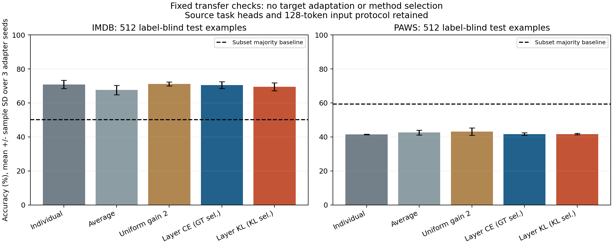

# 固定外部数据迁移检查：IMDb / PAWS

2026-10-25。为避免继续只在反复查看过的 GLUE validation 上推断，新增两项首次接触的目标子集检查：用 SST2 任务头在 IMDb test、MRPC 任务头在 PAWS labeled_final test。方法和系数在下载目标数据前固定，没有 target-domain 训练、calibration、step/gain 搜索或头部重训。数据与标签极性依据发布方的 [IMDb 数据卡](https://huggingface.co/datasets/stanfordnlp/imdb) 和 [PAWS 数据卡](https://huggingface.co/datasets/google-research-datasets/paws)。

两者各 label-blind 随机抽 512 条，sample seed 950125；对应 GLUE 全 train+validation 的 lowercase/whitespace 规范化精确排重，句对忽略顺序，本次排除 0 条。Hub revision、fingerprint、原始 row index、文本 SHA 和标签均记录于 [原始证据](artifacts/transfer-check-2026-10-25.json)。不声称近重复清除或无预训练污染。

五个方法为 individual、average、uniform gain2、原 GT-selection layerCE、后续 teacher-KL-selection layerKL。继续用原 `sentence_fields_v2` 与长度 128。三个 adapter 训练 seeds 42/43/44，共 30 次模型×目标集评估，均完成；不把五个不同方法当成独立训练重复。

## 结论与限制

IMDb 中各方法的三 seed 均值约 68–72%；layerKL 没有稳定胜过 uniform gain2 或 layerCE。**87% 样本超过 128-token 上限**，平均原始长度约 287 tokens，因此这同时是文本长度/截断的迁移检查，不能单独归因于参数合并。

PAWS 子集正例比例为 40.625%，多数类基线 accuracy 为 **59.375%**；所有方法只有约 41–43%，包括 individual。PAWS F1 约 0.58，也不能解释为具备可靠的释义泛化。原 MRPC adapter/head 的迁移已经很弱，不能仅把失败归因于合并。目标没有发生长度截断。

这是小型、固定的两数据集检查，不是完整 OOD benchmark；新目标第一次用于本项目的评估，但基础模型预训练语料接触情况未知。没有因为观察到负结果而调整长度、标签、数据子集或选更有利的方法。若今后改动协议，应在新的、独立目标数据上验证并明确记录探索过程。

详细 mean±sample SD 见 [汇总](artifacts/transfer-check-aggregate-2026-10-25.json)，不是测试样本置信区间。任务头仍由已知任务提供。原研究的 calibration 标签使用、validation 探索和新颖性限制见 [原型](PROTOTYPES-2026-10-25.md) 与 [选择控制](SELECTION-CONTROL-2026-10-25.md)。

执行约 110 秒；[固定方案](configs/transfer-check.json)、[代码](code/transfer_check/README.md)、SHA/CRC 与源码校验（本地记录） 均已归档。原文不随代码重新分发；数据按发布方渠道加载。
