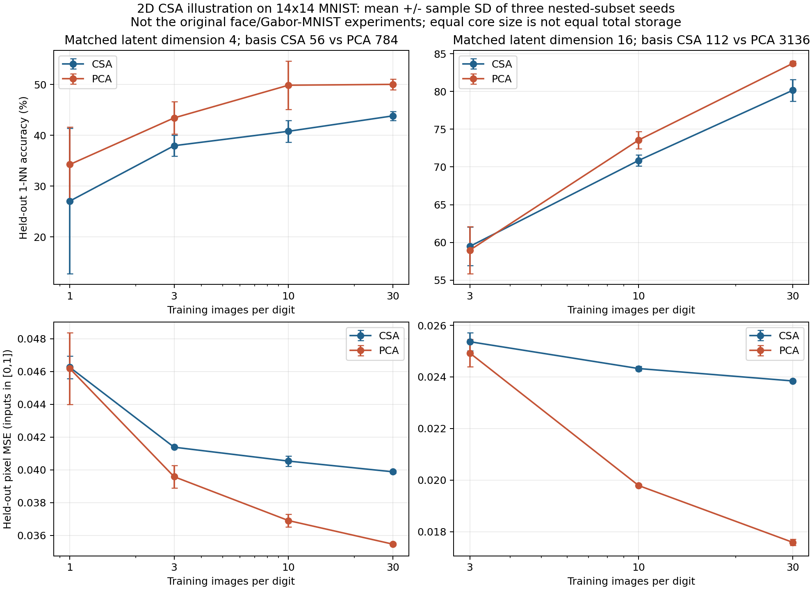
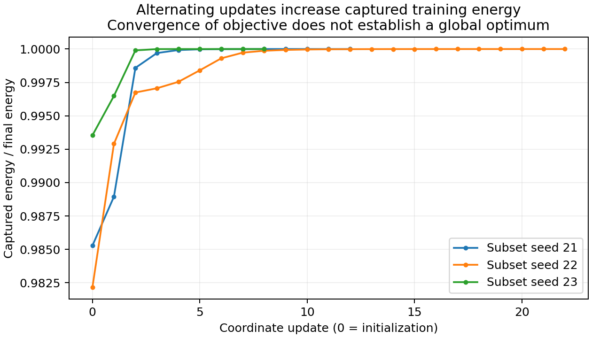

# 二维 CSA 补充复现：结果与可讲述结论

2026-10-25。完成 21 组匹配 latent 维数的 PCA/CSA 比较，共 42 个子空间；3 个 seed 的 `n=1/类, latent=16` 因中心化 PCA 样本秩不足而按方案跳过。两个核心数学测试在本地和 Colab 均通过；所有实际运行的列正交、目标单调、能量恒等式及 PCA 训练误差下界断言均通过。源码与拟合矩阵已 SHA/CRC 校验备份。

## 结果应怎样解释

在 14×14 灰度 MNIST、latent=16、每类 30 个训练样本时，CSA / PCA 的 1-NN accuracy 为 **80.2±1.4% / 83.7±0.3%**；测试 pixel MSE 为 **0.0238 / 0.0176**。每类 3 个样本时二者识别率为 59.5±2.6% / 59.0±3.1%，不能凭这一小差异宣称优势。latent=4 的所有训练规模下，PCA 平均识别率均更高。这组数据没有验证“CSA 在所有小样本下都更好”。

CSA 的优势是本次设置中的投影矩阵存储：latent=4 时 56 vs 784 个数；latent=16 时 112 vs 3,136 个数。这里**未计共同训练均值的 196 个数**，不是约束流形的自由度，也不是运行加速比。每个样本的 core 分别为 4 / 16 个数。比较维数相同，因而总存储不同；不等同于论文 Fig.5 的相同 compression ratio 比较。

固定训练集和 latent 维数时，PCA 搜索所有该维数线性子空间，CSA 仅搜索 Kronecker 可分离的一部分，因此 PCA 最优训练 MSE 不应高于 CSA。本次 21 对均满足。测试重建与识别是另外的指标，不由训练最优性直接推出；结构约束可能降低估计方差，也可能造成欠拟合。

## 与原论文的差别

原文实验包含 FERET、ORL、CMU PIE 与 MNIST；MNIST 部分使用原 native test 的前半部分及 28×28×40 Gabor 表示。本实验直接使用 native train / test 分离的灰度 MNIST，并下采样到 14×14；没有 Gabor、LDA 或人脸预处理，不能替代原表的复现。

冻结 [plan.json](plan.json) 的 scope 字符串误写了“face/USPS/Gabor tables”；原文并无 USPS 实验，正确应为“face/Gabor-MNIST tables”。该字符串原样保留在执行时方案与备份里便于核验；它不影响数值网格、数据 SHA 或结果，报告与图已更正。

训练 seed 21/22/23 对应三组嵌套训练子集；测试为固定、分层抽取的 1,000 张 native test 图像。误差棒是训练子集间 sample SD，不能解释为置信区间。降维只拟合训练图像，训练标签只用于 1-NN 参考与分层抽样。没有测试集选择配置；只有一次由行列协方差初始化的 CSA，不保证全局最优。

完整数字见 [结果表](artifacts/table-2026-10-25.md)、[原始 JSON](artifacts/summary-2026-10-25.json)、备份校验（本地记录）。
