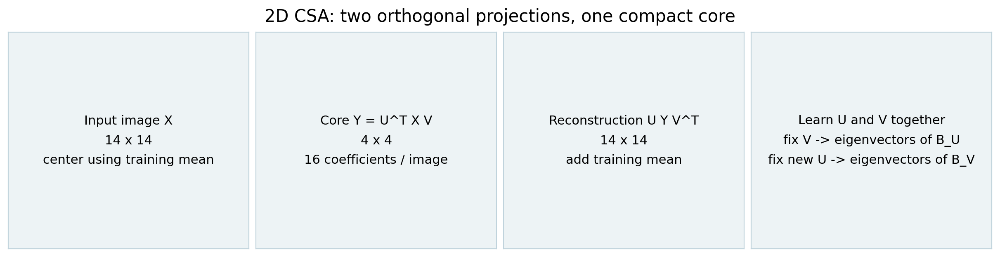
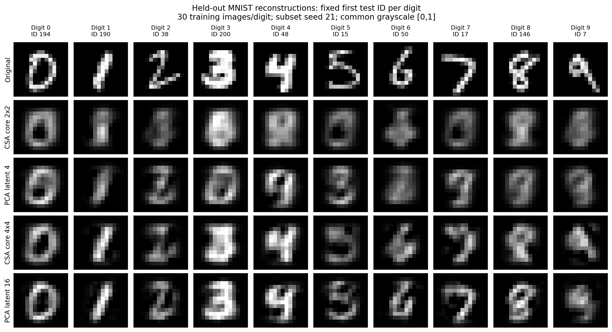
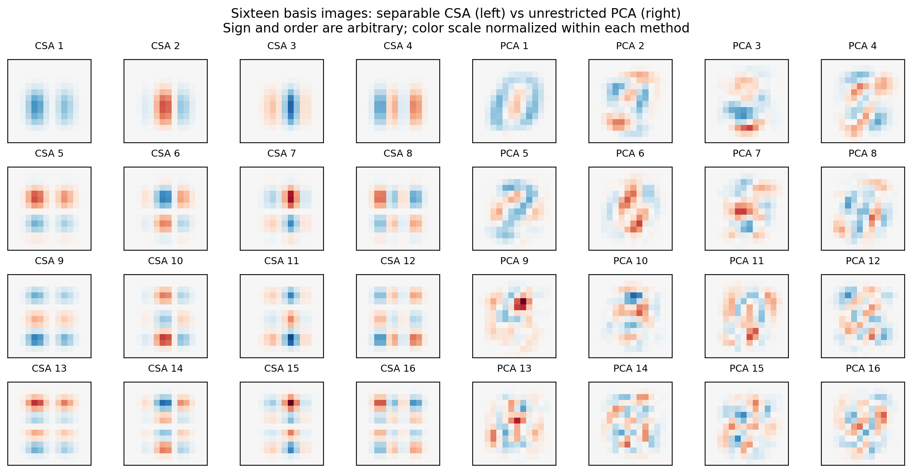
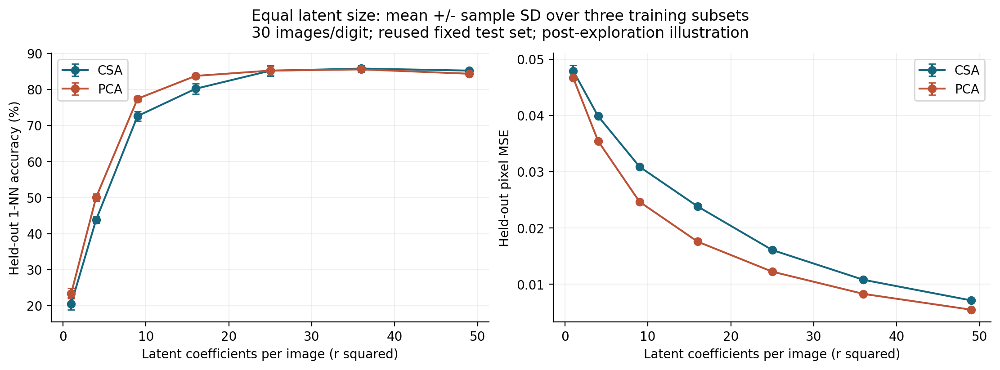
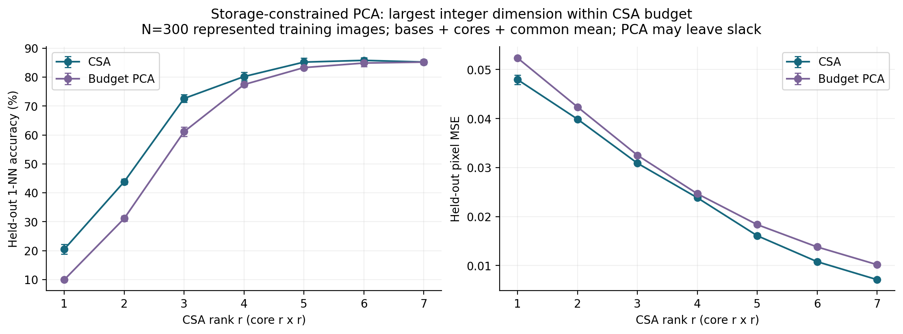
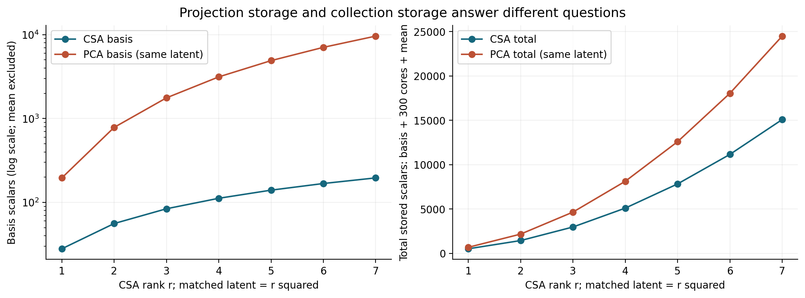
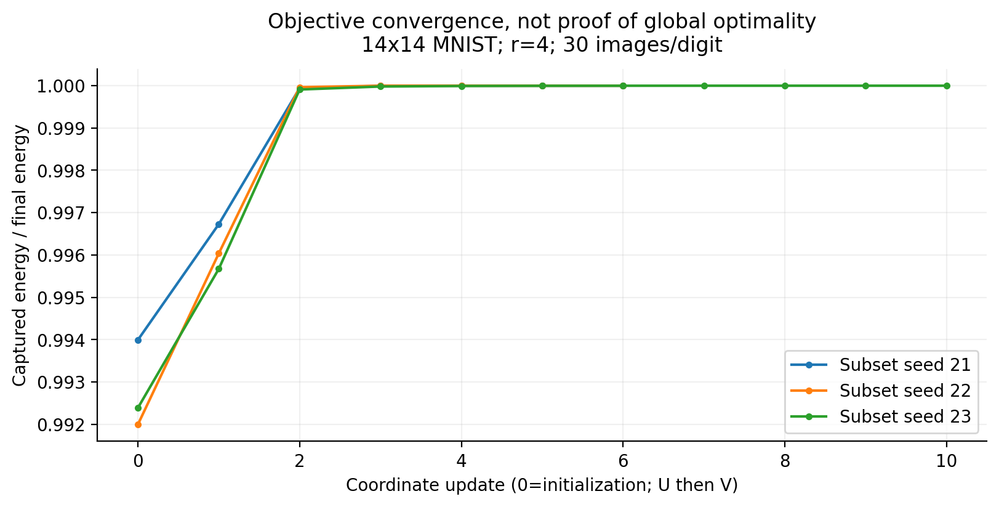
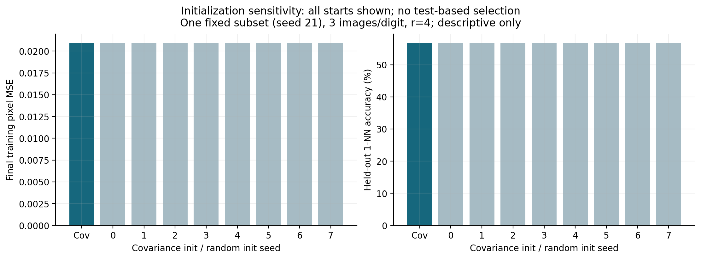
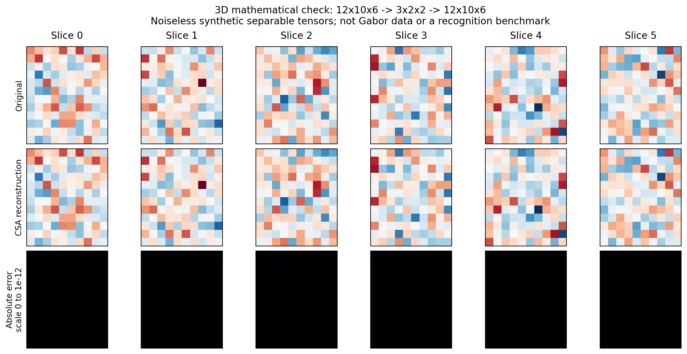
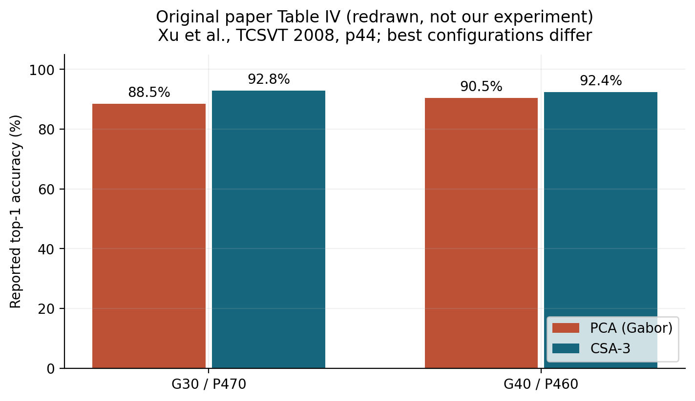

# 图表选择、图注和讲述建议

入口：[材料包](README.md) · [实验解释](EXPERIMENTS.zh-CN.md)

每图同时有 PNG（直接插入）和 SVG（矢量编辑）；文件在 [figures](figures/README.md)。图面保留英文以供英文展示，下面提供中英文讲述/图注。不要裁掉决定比较口径的副标题。新图全部由脚本生成，原文 Table IV 重绘单独标明。

## 01 — 投影流程（核心）

**用途**：介绍代码输入、core、重建及学习循环。对应原文 Fig.1 / Eq.(4)。X 在公式中指中心化后的图像。

**可讲**：一张 14×14 图像沿两个方向分别投影成 4×4 core，再用同一组正交基重建；U/V 从训练图像共同学习。

**English caption**: Two orthogonal mode projections map a centered image to a compact core and reconstruct it in the original pixel space. The projections are learned by alternating conditional eigendecompositions.

## 02 — 原图与重建（核心，直观）

每列一个数字，按固定 test subset 中最小 native ID 选择，没有按好坏挑例。训练为 seed 21、每类 30 张；CSA core 2×2 对 PCA d=4，CSA 4×4 对 PCA d=16。显示范围固定 [0,1]，超出范围的重建像素只在显示时被截断，MSE 用未截断值计算。

**可讲**：core 大小增加会保留更多细节；同一 latent 下两种方法的形状和笔画保留方式不同。十张展示图不能代表全部 test 的优劣，定量见 04。

**English caption**: Fixed held-out examples reconstructed by CSA and PCA at matched latent dimensions. Examples are selected by native test ID, not reconstruction quality. This is our 14×14 grayscale illustration.

## 03 — 学到的 basis（可选）

左边 16 张为 CSA 的 `u_a v_b^T`；右边是 PCA 的 16 个向量 reshape。每边内部共用对称色标，两边分别归一化。正负号和排序可变，没有类别语义保证。

**可讲**：CSA 的每个 basis image 是两个一维向量的外积，这正是其可分离约束；PCA 不受这类外积结构限制。不要把 basis 图叫作“每类数字模板”。

**English caption**: CSA basis images are separable outer products; PCA basis images are unrestricted. Signs and ordering are arbitrary, and colors are normalized within each method.

## 04 — 相同 latent 的识别与重建（核心结果）

三组训练子集，每类 30 张，r=1…7 全部报告；误差棒为训练子集间 sample SD，固定同一 1,000 图 test。不是置信区间。

**可讲**：同 latent 下 PCA 的测试重建 MSE 在所有这些点更低；识别准确率差异随维数变化。小 core 时 PCA 识别更好，高维处数值接近，不挑 rank 宣称普遍优势。

**English caption**: Equal-latent comparison on 14×14 grayscale MNIST, reporting all seven ranks. Error bars show sample SD over three training subsets sharing a fixed, previously explored test set.

## 05 — 存储约束改变比较对象（核心解释）

固定要存 N=300 张训练图的 cores，计入 basis 和共同均值。对每个 CSA r，PCA 选不超过此预算的最大整数 d。PCA 实际可能留有余量，故不是“总存储精确相等”。r=1 的预算容不下一个 PCA 方向，退化 d=0，1-NN 全距离打平后固定返回首个训练标签，accuracy 为 10%。该点应口头说明或放附录，不能渲染成强 baseline。

**可讲**：r=4 时 CSA 用 16 个 core 系数，而预算内 PCA 只能用 9 个；此处准确率约 80.17% 对 77.40%，test MSE 约 0.02384 对 0.02466。该预算网格的平均 test MSE 均为 CSA 较低，与 04 的结论不同，因为问的问题和允许的维数不同。不要外推到其他存储规模或数据。

**English caption**: PCA uses the largest integer dimension fitting within each CSA storage budget, including bases, 300 training-image cores and a shared mean. Dimensions differ and unused PCA budget remains; this is not the original Fig.5 experiment.

## 06 — basis 与总存储（核心）

左图 basis 数量用 log 轴；右图算 300 张 core、basis 和均值。r=4：CSA basis=112，PCA basis=3136；总数为 5108 对 8132。不能把 basis 的 28 倍差异称为整套存储 28 倍。

**English caption**: Basis storage and collection storage differ. At latent dimension 16, CSA stores 112 basis scalars versus PCA's 3,136, but with 300 cores and a common mean the totals are 5,108 and 8,132 scalars.

## 07 — 迭代收敛（核心代码证据）

横轴为单次坐标更新，0 是初始化，一次 sweep 两个点；各曲线除以自己的最终能量。纵轴被放大以看清小的增益，不能据此说能量从 0 增到 1。原文 Fig.4 画的是投影相似度，这张不是其复现。

**English caption**: Captured training energy is nondecreasing after each conditional update. The ordinate is normalized by each run's final energy; objective convergence does not establish a global optimum.

## 08 — 初始化检查（附录）

固定 seed21、每类 3 张、r=4；covariance 加八个随机初始化均报告。所有运行 accuracy 都是 56.8%，最终训练 MSE 差异小于 2e−10，约 5–7 sweeps。这里没有发现实质性敏感性，不应捏造不同局部最优。

**English caption**: Covariance initialization and eight seeded random starts reach numerically similar solutions on one fixed subset. No test-based initialization selection is performed; this observation is not a global-optimality proof.

## 09 — 三维重建验证（附录／展示高阶实现）

无噪声合成可分离张量，50 个训练、20 个新样本，12×10×6→3×2×2。图展示第一个 held-out 样本全部六个切片；绝对误差统一色标 0…1e−12。误差最大约 1.78e−15，接近浮点数精度。

**English caption**: A three-mode CSA implementation reconstructs held-out noiseless separable tensors to numerical precision. This validates tensor algebra under a known model; it is not an image-recognition benchmark.

## 10 — 原论文 Table IV（论文结果）

数字来自原文 PDF p9 / 期刊 p44，视觉核对，详细配置见 [原文证据](PAPER-EVIDENCE.zh-CN.md)。来源必须保留，不能把柱状图放在“our results”下面。作者报告最佳配置，两方法维数不同。

**English caption**: Redrawn from Xu et al., IEEE TCSVT 18(1), 2008, Table IV, p.44, DOI: 10.1109/TCSVT.2007.903317. These are author-reported best-configuration results on Gabor MNIST, not our measurements.

## 一句总解释

**可直接放讲稿**：我们验证了 CSA 的投影、交替更新和结构约束，并用灰度 MNIST 展示维数、存储和识别之间的取舍；原论文的三维 Gabor 结果另行引用，不能与本次二维实验混作同一 benchmark。
