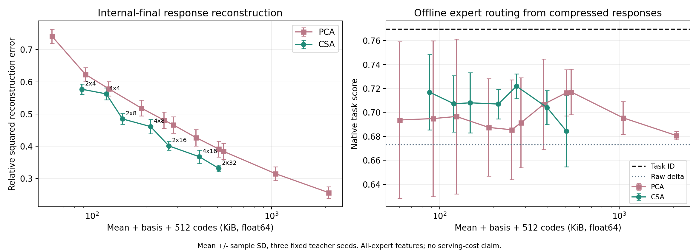
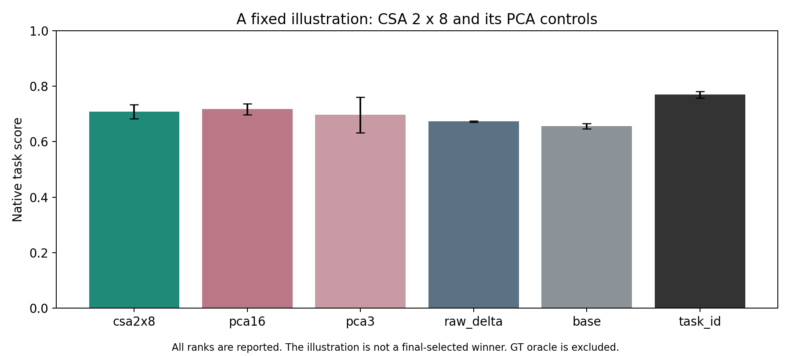

# 选文—Part 1—Part 2：直接 CSA 桥接、结果与答辩

2026-11-11。现在的联系已进入实际代码：Part 2 直接导入 Part 1 的 `TensorCSA`，用于压缩同一输入在多个 LoRA expert 下的功能响应。原有 LoRA 权重合并实验保留为主线；新增的是功能表示分支，不把它说成 CSA 权重合并。

## 1. Presentation 主线怎么讲

**选文提出方法 → Part 1 理解和验证方法 → Part 2 把相同方法迁移到现代模型的真实对象，并检验效用。**

| 层次 | 对象与问题 | 方法及证据 |
|---|---|---|
| 选定 CSA 论文 | 张量对象如何紧凑表示，并保留重建/识别信息 | mode 子空间、正交投影、交替条件更新、Kronecker 约束 |
| Part 1 | 图像的二维/高阶结构是否体现 CSA/PCA 的空间—误差取舍 | 自实现 CSA、MNIST、数学验证；区分等 latent 与计 basis 的预算 |
| Part 2 原主线 | 多任务 LoRA 如何合并或选 expert，功能相似度是否有用 | 固定基线、同容量 CE/KL、真实/shuffled hidden、路由/安全回退 |
| Part 2 新桥接 | 多 expert 功能响应是否也适合 CSA，其紧凑表示是否保留有用信息 | **同一个 TensorCSA** 处理 expert×feature 矩阵；PCA 双预算对照；离线 expert selection 检查 |

从 Part 1 接过来的问题不是“CSA 在图像好，所以在 LLM 一定好”，而是“同样的结构约束，在新的表示对象上会带来怎样的空间、重建和任务效用取舍？”

## 2. 具体代码与论文怎么对应

每个输入 x，以四个 adapter 的最后层 masked-mean hidden response 减去对应 base response，组成 `X(x)∈R^(4×896)`。行是 expert，列是同一 backbone 的 hidden coordinate；两个轴有明确含义，没有任意把896维切成假图像，也不把样本数当一个 mode。

中心化后，`core = U.T @ (X - mean) @ V`，重建为 `U @ core @ V.T + mean`。U 压缩 expert 方向，V 压缩 hidden-feature 方向。这直接沿用论文 Eq.(4)–(6)、Theorem 1 / Procedure 1 的投影、重建和条件更新机制；并非从“也是低秩”推导二者相同。

- [Part 1 原 TensorCSA](../part1-reproduction-20261025/code/csa_tensor.py)：实际被导入，未改动。
- [Part 2 桥接实现](../code/csa_bridge.py)：收集响应、拟合 CSA/PCA、选择 C、锁定后 final 评估。
- [独立复算](../code/summarize_csa_bridge.py)：重载 mean/bases/scalers/router 参数，重算重建、selection 分数与 final routes/metrics。
- [四项数学/预算检查](../code/test_csa_bridge.py)：Kronecker 等价、能量恒等式/单调、等 latent PCA 训练最优性、预算取整。
- [冻结协议](CSA-BRIDGE-PROTOCOL.zh-CN.md) 与 [全部原始证据](../artifacts/csa-bridge-2026-11-11/README.md)。

协方差初始化、能量停止与中心化是我们 Part 1 已说明的实现约定，不称逐细节复现原论文，也不声称联合全局最优。

## 3. 可以直接用于 PPT 的三行结果

三训练 seed 的内部 final，误差为 relative squared reconstruction error，越低越好。存储计512条响应的 mean+basis+codes，均 float64；KiB=1024 bytes，不是ZIP大小。这里的 native score 与官方validation复评是不同分区，不能混成一张无标注表。

| 表示 | latent | 表示存储 KiB | final 相对平方重建误差 | 离线路由 native score |
|---|---:|---:|---:|---:|
| csa2x8 | 16 | 148.1 | 0.4848 ± 0.0167 | 0.7080 ± 0.0250 |
| pca16 | 16 | 540.0 | 0.3843 ± 0.0247 | 0.7171 ± 0.0190 |
| pca3 | 3 | 124.0 | 0.5785 ± 0.0220 | 0.6966 ± 0.0646 |

**读法一：相同 latent=16。** CSA用148.1 KiB，PCA用540.0 KiB，相差约3.65倍；PCA重建误差更低。这是结构约束减少basis开销、同时限制表示自由度的实证。

**读法二：以CSA存储为上限。** PCA最多保留3维，用124.0 KiB；增加到4维就超出148.1 KiB，因此留有整数预算余量。CSA重建误差0.4848低于预算PCA的0.5785。全七组rank均公开；三seed均值下，七组CSA都比各自预算PCA的重建误差更低。该结果依赖本缓存大小、数据、精度和rank网格，不是CSA普遍优于PCA。

**读法三：再看任务效用。** CSA2×8路由0.7080，PCA16为0.7171，PCA3为0.6966；raw delta为0.6729，base为0.6559，直接task-ID为0.7695。压缩可以改变监督路由的泛化，但不凭这些均值断言机制或显著优势。CSA也未胜过已知task-ID参照。

第一个图建议作为主图：先讲左边预算取舍，再讲右边效用并非随重建单调改善。第二个图适合作为QA备份。误差线是三seed样本标准差，不是置信区间。

## 4. 为什么这也联系原 proposal

Proposal提出以adapter的功能行为指导合并或选择。前面的CE/KL、hidden/shuffled和router实验检验“功能代理是否改善任务”；CSA桥接进一步检验“这些功能响应如何紧凑表示、压缩后是否仍有选择expert的信息”。因此功能响应是两条实验线共同的对象：一条检验其作为优化目标的价值，一条检验其结构化表示的价值。

研究结论分开说：学习合并系数能改善当前固定基线；真实hidden配对的独特收益未成立；CSA在响应缓存中显示明确的basis/latent预算取舍；离线压缩响应router仍未超过task-ID。这四点可以同时成立。

## 5. 建议增加两页 PPT

**新增页A：From CSA to structured adapter responses（约45–60秒）**

- 左：CSA原文的图像张量与各mode投影。
- 中：Part 1 的 `U.T @ X @ V`、CSA/PCA双预算验证。
- 右：Part 2 的 `expert × hidden feature`、同一实现、core与response reconstruction。
- 页脚：`Same mechanism, new tensor object; response compression, not weight compression.`

**新增页B：Compactness does not guarantee task utility（约60秒）**

- 使用上面三行表或完整存储图左半边：等latent PCA更准，CSA更省basis；等预算CSA保留更多latent并降低重建误差。
- 加一句任务结果：所有响应router仍低于task-ID；需要全部expert前向，暂不主张加速。
- 把旧重复基线/细节移到backup，确保总讲述仍符合课程时长，而非直接给原有讲稿再加两分钟。

## 6. 可直接口述的英文

> In Part 1, we studied CSA as a structured alternative to vector PCA. In Part 2, we apply the same CSA implementation to a new object: a matrix of LoRA expert responses for each input. We compare equal latent sizes and storage budgets that include the bases. CSA gives a more compact representation, with a reconstruction trade-off relative to PCA. We then test whether the compressed responses retain useful information for expert selection. This connects the selected paper to our implementation and experiments, while keeping response compression separate from weight merging and serving efficiency.

结果补充：

> At sixteen latent coefficients, CSA uses about 148 KiB compared with 540 KiB for PCA. PCA reconstructs better at that latent size. Under the CSA storage ceiling, however, PCA can keep only three coefficients, and CSA has lower reconstruction error. The resulting offline router still trails task-ID selection, so we do not claim a deployable routing advantage.

## 7. 教授可能追问的12组 QA

**Q1. Where exactly is CSA used in Part 2?**

`csa_bridge.py` imports the unchanged Part 1 TensorCSA and fits its mode bases on expert-by-feature response matrices. It is an operational reuse of the algorithm, not just a low-rank analogy.

**Q2. Are you merging LoRA weights with CSA?**

No. Our original weight merging uses learned mixtures of ΔW. The CSA branch compresses functional-response objects and probes their utility for expert selection. We keep these contributions distinct.

**Q3. Why is this a tensor rather than a reshaped vector?**

Each input has four expert responses in shared hidden coordinates. Expert identity and hidden feature are the two modes. We do not invent spatial adjacency or use sample index as a mode.

**Q4. Why should the expert and feature modes be separable?**

That is a structural assumption we test. The restricted Kronecker basis lowers basis storage but may lose interactions that vector PCA can model. Equal-latent reconstruction exposes that cost.

**Q5. How does the optimization relate to the paper?**

We minimize tensor reconstruction error with orthonormal mode bases. Fixing one basis gives a conditional eigenspace update for the other, as in the paper's method. Our initialization and stopping convention are documented; we do not claim global optimality.

**Q6. Why does PCA reconstruct better at equal latent size?**

Its vector projection is more general. CSA restricts the basis to a Kronecker structure. We explicitly check PCA's training reconstruction advantage at equal latent size; the test is not designed to make CSA win everywhere.

**Q7. What is included in the storage figure?**

The fit mean, learned basis and 512 encoded response objects, at equal float64 precision. It excludes the base model, adapters, logits, router and file overhead. The comparison concerns the response representation only.

**Q8. Does the 3.65-fold reduction always hold?**

No. It is the measured accounting for this rank pair and N=512. As more cached objects amortize the bases, the same-latent ratio moves toward one. Different ranks, precision and cache sizes change it.

**Q9. Did you use final labels to choose the CSA ranks?**

No best rank is selected on final. We publish all seven frozen rank pairs. Basis fitting uses fit responses without labels; router regularization uses selection labels. The final partition had been explored before, which we disclose.

**Q10. If all experts must run, what is the point of routing?**

Here routing is an offline information-retention probe, not a serving strategy. It asks whether a compressed functional profile preserves information relevant to expert choice. We do not claim reduced inference cost.

**Q11. Why can compressed features outperform raw features?**

Dimension reduction changes the supervised router's capacity and regularization. Our results are consistent with that possibility, but do not identify it as the cause. Raw, PCA and CSA controls help avoid attributing every difference to tensor structure.

**Q12. What is your contribution beyond the selected paper?**

We transfer the same algorithm to real multi-adapter response matrices, make storage comparisons explicit, and evaluate both reconstruction and task utility under separated fit/selection roles. It is an empirical application and analysis, not a newly invented CSA algorithm or state-of-the-art merger.

## 8. 复现与备份

三seedID与原角色完全一致；重载basis重建、router参数、selection分数和final routes独立复算通过。全部32项云端代码测试通过，中英notebook已包含新源码、配置和检查。17页整合报告第8节给方法与结果，第13–15页可直接用于阅读。

完整响应缓存和投影/router参数保存在单独state ZIP并核对SHA/CRC；Git仅发布派生logits/labels/routes、指标、ID、源码和备份校验记录。重计算全在Colab。正式提交、PPT制作和组内演练由团队完成。
