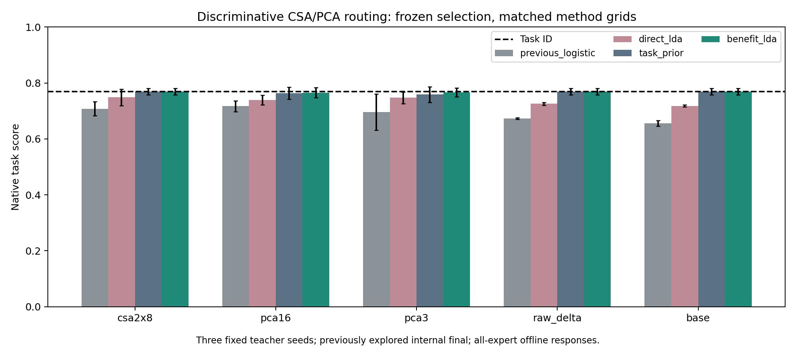
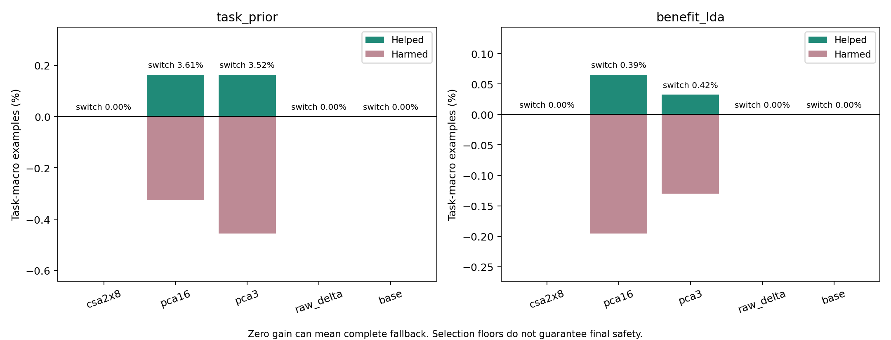

# CSA＋判别学习：提升了多少，是否接近task-ID？

2026-11-11。**固定CSA2×8的直接路由native从0.7080提升到0.7485；平均任务accuracy从80.11%提升到81.97%，距离task-ID的82.52%约0.55个百分点。** 这是发生实际切换的直接LDA结果，不是回退得到的数值。保守gate则选择全部回退，因此与task-ID相同，但不能算学出了有益切换。

本轮三teacher seed和响应缓存均与上轮相同，不是新增独立训练重复。所有选择仅用原selection，内部final曾被探索，不能称未见盲测。该表示仍需全部expert前向，不主张推理加速。

## 1. 为什么这与选文更紧密

选文将CSA用于紧凑表示，并在部分识别实验中接LDA。我们沿用“结构化重建表示 → 判别处理 → 任务检验”：Part1用图像说明CSA/PCA的空间—重建取舍；Part2先将CSA直接用于expert×feature矩阵，再接正则化LDA判断expert/切换效用。CSA basis保持无标签拟合，监督发生在后续LDA，不称新发明的监督CSA。

原始CSA重建目标不使用类别；LDA利用类内/类间统计建立判别函数。这里类别是minimum-NLL expert，或相对own expert的help/tie/harm，而非原论文的人脸/数字类别。这是一项明确的数据对象与监督目标迁移。

## 2. 主要对照：相同表示，替换判别/门控方法

native是SST2/RTE accuracy、MRPC (accuracy+F1)/2、CoLA MCC的平均；下表不是accuracy百分比。±为三个训练seed的样本SD。task-ID native为 **0.7695±0.0114**。

| 表示 | 上轮logistic | Direct LDA | Task prior gate | Benefit LDA gate |
|---|---:|---:|---:|---:|
| csa2x8 | 0.7080 ± 0.0250 | 0.7485 ± 0.0290 | 0.7695 ± 0.0114 | 0.7695 ± 0.0114 |
| pca16 | 0.7171 ± 0.0190 | 0.7394 ± 0.0169 | 0.7630 ± 0.0213 | 0.7652 ± 0.0177 |
| pca3 | 0.6966 ± 0.0646 | 0.7474 ± 0.0208 | 0.7590 ± 0.0279 | 0.7662 ± 0.0161 |
| raw_delta | 0.6729 ± 0.0023 | 0.7258 ± 0.0048 | 0.7695 ± 0.0114 | 0.7695 ± 0.0114 |
| base | 0.6559 ± 0.0098 | 0.7182 ± 0.0033 | 0.7695 ± 0.0114 | 0.7695 ± 0.0114 |

固定的CSA2×8下，LDA的native均值高于同latent PCA16的LDA（0.7394）以及raw delta的LDA（0.7258）。这些是三seed描述性结果，不证明普遍优势或显著性，也不据此挑选另一rank作主结论。

## 3. “接近”体现在哪里？

| 固定CSA2×8，内部final | native | 平均任务accuracy | 实际切换比例 |
|---|---:|---:|---:|
| 原logistic | 0.7080 | 80.11% | 19.43% |
| 正则化Direct LDA | 0.7485 | 81.97% | 11.49% |
| task-ID | 0.7695 | 82.52% | 0% |

native差距从0.0614缩至0.0210，平均accuracy差距从约2.41 pp缩至0.55 pp。不能把“差0.55pp”说成统计等效；native和accuracy也不是同一指标。

帮助/损害揭示了更具体的变化：原logistic帮助1.302%、损害3.711%；Direct LDA帮助0.651%、损害1.204%。LDA减少了有害切换，也减少了一部分有益切换，净损失因此缩小。它尚未变成净收益为正的路由，不能讲成全面超过own expert。

## 4. Gate必须看真实行为

| 表示 | gate | switch | helped | harmed | accuracy相对task-ID | 选择always-own |
|---|---|---:|---:|---:|---:|---:|
| csa2x8 | task_prior | 0.000% | 0.000% | 0.000% | +0.000 pp | 3/3 |
| csa2x8 | benefit_lda | 0.000% | 0.000% | 0.000% | +0.000 pp | 3/3 |
| pca16 | task_prior | 3.613% | 0.163% | 0.326% | -0.163 pp | 2/3 |
| pca16 | benefit_lda | 0.391% | 0.065% | 0.195% | -0.130 pp | 2/3 |
| pca3 | task_prior | 3.516% | 0.163% | 0.456% | -0.293 pp | 2/3 |
| pca3 | benefit_lda | 0.423% | 0.033% | 0.130% | -0.098 pp | 2/3 |
| raw_delta | task_prior | 0.000% | 0.000% | 0.000% | +0.000 pp | 3/3 |
| raw_delta | benefit_lda | 0.000% | 0.000% | 0.000% | +0.000 pp | 3/3 |
| base | task_prior | 0.000% | 0.000% | 0.000% | +0.000 pp | 3/3 |
| base | benefit_lda | 0.000% | 0.000% | 0.000% | +0.000 pp | 3/3 |

CSA2×8两个gate三seed均选择always-own，保住基线。PCA对照有少量实际切换，但selection约束没有保证final净收益。这是必须保留的对照：相同分数可来自完全回退，也可来自有风险的实际切换，不能只报最终柱高。

help−harm等于macro accuracy变化，不等于native变化。所有分区每任务样本数相同，因此当前总体switch fraction同时具有等任务权重；不能将这个结论不加说明移到任务样本数不同的官方validation。

## 5. 固定CSA2×8的逐seed选择与结果

| seed | 方法 | α | margin/threshold | native | switch | accuracy delta |
|---|---|---:|---:|---:|---:|---:|
| 42 | direct_lda | 0.1 | -1 | 0.7686 | 2.246% | +0.098 pp |
| 42 | task_prior | 1.0 | always-own | 0.7676 | 0.000% | +0.000 pp |
| 42 | benefit_lda | 1.0 | always-own | 0.7676 | 0.000% | +0.000 pp |
| 43 | direct_lda | 0.5 | -1 | 0.7616 | 15.332% | -0.684 pp |
| 43 | task_prior | 1.0 | always-own | 0.7816 | 0.000% | +0.000 pp |
| 43 | benefit_lda | 1.0 | always-own | 0.7816 | 0.000% | +0.000 pp |
| 44 | direct_lda | 0.1 | -1 | 0.7152 | 16.895% | -1.074 pp |
| 44 | task_prior | 1.0 | always-own | 0.7591 | 0.000% | +0.000 pp |
| 44 | benefit_lda | 1.0 | always-own | 0.7591 | 0.000% | +0.000 pp |

## 6. 全部CSA rank，避免挑最好结果

| rank | Direct LDA | Task prior | Benefit LDA |
|---|---:|---:|---:|
| csa2x4 | 0.7436 ± 0.0347 | 0.7509 ± 0.0416 | 0.7511 ± 0.0271 |
| csa2x8 | 0.7485 ± 0.0290 | 0.7695 ± 0.0114 | 0.7695 ± 0.0114 |
| csa4x4 | 0.7515 ± 0.0222 | 0.7637 ± 0.0196 | 0.7662 ± 0.0161 |
| csa2x16 | 0.7486 ± 0.0052 | 0.7692 ± 0.0110 | 0.7695 ± 0.0114 |
| csa4x8 | 0.7473 ± 0.0164 | 0.7656 ± 0.0179 | 0.7695 ± 0.0114 |
| csa2x32 | 0.7360 ± 0.0160 | 0.7627 ± 0.0218 | 0.7695 ± 0.0114 |
| csa4x16 | 0.7404 ± 0.0115 | 0.7660 ± 0.0166 | 0.7695 ± 0.0114 |

全部PCA/raw/base、所有选择候选、派生预测和完整逐seedCSV见 [证据目录](../artifacts/csa-discriminant-2026-11-11/README.md)。每seed独立复算760个selection候选，共2,280个；selected final routes重载完全一致，help/harm恒等式通过。全部37项云端代码测试通过，双语notebook已同步。

## 7. 代码与方法说明

- [csa_discriminant.py](../code/csa_discriminant.py)：共享类内协方差LDA，收缩α=.1/.5/.9；高维使用Woodbury等价求解，含单类/退化方差处理。
- [test_csa_discriminant.py](../code/test_csa_discriminant.py)：与标准LDA数值一致性、缺失类别、own优先、严格阈值、selection拒绝/平分回退。
- [summarize_csa_discriminant.py](../code/summarize_csa_discriminant.py)：从保存系数重算每个selection候选和最终路线，独立重算指标与help/harm。
- [冻结协议](CSA-DISCRIMINANT-PROTOCOL.zh-CN.md)：数据权限、三个目标、网格与选择规则。所有表示使用相同网格；不同维数仍有不同统计难度，不能称控制了全部容量因素。

Direct LDA仍拟合minimum-GT-NLL expert。Task prior仅在其他expert后验超过own一定margin时切换。Benefit LDA学习每个候选的help/tie/harm，以P(help)−P(harm)估计收益；其own-task恒零行不用于该候选拟合，因此每个benefit分类器用384条，而expert分类器用512条。两者信息来源相同但监督任务和拟合样本数不同。

## 8. Presentation怎么更新

将之前桥接页的“CSA压缩→logistic路由”升级为“CSA压缩→判别学习→实际切换效用”，使用如下两图。主讲固定CSA2×8的旧logistic、Direct LDA和task-ID三行；PCA与gate放同页小表或backup。旧的官方validation表属于另一个分区，勿与本次内部final行混合而不标注。

**一分钟英文讲述：**

> The selected paper combines structured tensor representations with discriminative processing. Following that idea, we keep the CSA response representation fixed and replace the logistic expert selector with regularized LDA. At the fixed two-by-eight CSA setting, the native score improves from 0.7080 to 0.7485. Mean task accuracy reaches 81.97 percent, compared with 82.52 percent for task-ID selection. This direct router makes real switches, so the improvement is not explained by complete fallback. However, harmful switches still exceed helpful ones. Our conservative gates select the original task expert instead, preserving the baseline without demonstrating an additional routing benefit.

## 9. 八组追加QA

**Q: Did you reach task-ID performance?**

Direct LDA narrows the gap to about 0.55 macro-accuracy points at the fixed CSA setting, but its native score remains lower. The gates match task ID by selecting always-own. We distinguish proximity, fallback equality and a genuine routing gain.

**Q: How is this connected to the CSA paper?**

We reuse CSA itself for response representation, then test discriminative processing as in the paper's representation-plus-recognition perspective. Our supervision predicts useful experts rather than object identities; the application and labels differ.

**Q: Why does LDA help?**

The measured change is fewer harmful switches under a different discriminant and regularization family. Shrinkage stabilizes covariance estimation under its assumptions. The experiment does not establish a unique causal mechanism or universal superiority over logistic regression.

**Q: Is this supervised CSA?**

The CSA bases are frozen and still learned without labels. LDA and gate fitting are supervised. We do not modify CSA's reconstruction objective or claim a new supervised tensor algorithm.

**Q: Are the probability thresholds safety guarantees?**

No. LDA probabilities are model-based estimates and are not proven calibrated. The floors constrain selection results only; PCA controls demonstrate that final switches can still cause harm.

**Q: If the gate returns the original expert, did it learn anything useful?**

Its observed decision is to retain the available reference. We report that as baseline preservation. The evidence of actual classifier improvement comes from Direct LDA, which switches on all three seeds, rather than from the fallback score.

**Q: Is CSA necessary for this improvement?**

PCA, raw-delta and base controls also use the same LDA/gate grids. The fixed CSA setting has a higher mean direct-LDA score than these illustrated controls, but three seeds and one data partition do not prove a general or significant CSA advantage.

**Q: Why not keep searching until it beats task ID?**

Repeated final inspection already makes this exploratory. Further confirmatory claims require an untouched evaluation partition and a frozen method. We retain the current limits instead of choosing the best final rank or threshold after seeing results.

## 10. 当前结论

这轮强化取得了有实际切换的直接路由提升，并使平均任务准确率接近task-ID；尚未实现稳定净增益。CSA缓存的存储—重建取舍、LDA判别提升和保守回退是三项不同发现，报告中分别阐释。代码与报告已具备课程讲述材料，不将近似结果包装成等效或SOTA。
